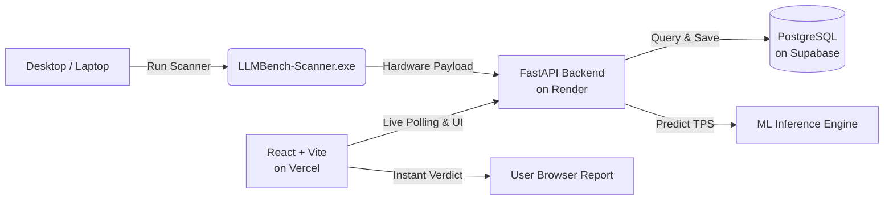

<p align="center">
  <a href="https://llmbench.vercel.app">
    
  </a>
</p>

<h1 align="center">LLM Bench</h1>

<p align="center">
  <strong>Know which open-source LLMs your PC can run with zero guesswork.</strong><br>
  Instant hardware compatibility verdicts, VRAM fit checks, and machine learning token generation speed predictions.
</p>

<p align="center">
  <a href="https://github.com/kamalesh-io/llm-banch/actions/workflows/ci.yml">
    
  </a>
  <a href="https://github.com/kamalesh-io/llm-banch/releases/latest">
    
  </a>
  <a href="https://llmbench.vercel.app">
    
  </a>
  <a href="https://llm-banch.onrender.com/docs">
    
  </a>
  <a href="https://github.com/kamalesh-io/llm-banch/blob/main/LICENSE">
    
  </a>
</p>

<p align="center">
  <a href="https://llmbench.vercel.app"><strong>Live Web App</strong></a> •
  <a href="https://llm-banch.onrender.com/docs"><strong>Interactive API Docs</strong></a> •
  <a href="https://github.com/kamalesh-io/llm-banch/releases/latest"><strong>Download Windows Scanner (.exe)</strong></a> •
  <a href="#-quickstart"><strong>Quickstart</strong></a>
</p>

---

## ⚡ The Problem

Downloading local open-weight LLMs (like Llama 3, DeepSeek, Mistral, or Qwen) often means pulling **8 GB to 30 GB** model weights, only to find out:
- Your GPU ran **Out of Memory (OOM)** because KV-cache headroom wasn't budgeted.
- The model spilled into system RAM, crawling at **0.8 tokens/second**.
- You picked the wrong quantization (`Q8_0` instead of `Q4_K_M`) for your available VRAM.

**LLM Bench** eliminates the guesswork. In 2 seconds, our lightweight scanner identifies your exact GPU, VRAM, and RAM, calculates dynamic quantization fits, and predicts tokens-per-second before you hit download.

---

## ✨ Features

- 🔍 **2-Second Hardware Inspection:** Lightweight, standalone Windows GUI scanner auto-detects NVIDIA CUDA GPUs, AMD Radeon, Intel Arc, and system memory.
- 🎯 **Physics + ML Speed Predictor:** Ridge regression inference engine trained on empirical LLM configurations predicts generation speeds (`tok/s`) across full GPU offload, CPU fallback, and partial layer offloading.
- 📐 **Dynamic Quantization Fit Matrix:** Real-time calculation of model weights + KV-cache footprint (with a 15% safety stopgap) across GGUF formats (`Q4_K_M`, `Q5_K_M`, `Q8_0`, `FP16`).
- 🏷️ **Clear Verdicts:** Immediate classification for every quant:
  - 🟢 **Recommended** (Full GPU offload, high throughput)
  - 🟡 **Minimum** (Acceptable performance, partial CPU offload)
  - 🔴 **Not Recommended** (RAM bottleneck, unusable speed)
- 🏆 **Interactive Leaderboard:** Filter 20+ models and 47+ quantizations by coding benchmarks, MMLU quality ratings, memory efficiency, and generation speed.
- 🔒 **Privacy-First Architecture:** No personal data collected. Scans generate short-lived ephemeral session tokens and auto-expire in 15 minutes.

---

## 🏗️ Architecture



### Tech Stack

| Domain | Technologies |
| :--- | :--- |
| **Frontend** | React 18, Vite, Tailwind CSS, Framer Motion, Lucide Icons |
| **Backend** | FastAPI, Python 3.12, SQLAlchemy, Pydantic v2, Uvicorn |
| **Database** | PostgreSQL on Supabase (with SQLite fallback for local testing) |
| **ML Engine** | Scikit-learn (Ridge Regression), Pandas, NumPy |
| **Desktop Scanner** | Python, CustomTkinter, PyInstaller (single standalone `.exe`) |
| **Hosting & CI** | Vercel (Frontend), Render (Backend), GitHub Actions (CI/CD) |

---

## 🚀 Quickstart

### Prerequisites

- **Node.js** >= 18
- **Python** >= 3.11
- **Git**

### 1. Clone the repository

```bash
git clone https://github.com/kamalesh-io/llm-banch.git
cd llm-banch
```

### 2. Run Backend (FastAPI)

```bash
cd backend
python -m venv venv

# Windows:
venv\Scripts\activate
# Linux/macOS:
# source venv/bin/activate

pip install -r requirements.txt
pip install -r requirements-dev.txt

# Run server with local SQLite or configured DATABASE_URL:
uvicorn main:app --reload --port 8000
```

> **API Documentation:** Open `http://localhost:8000/docs` in your browser for Swagger UI.

### 3. Run Frontend (React + Vite)

```bash
cd ../frontend
npm install
npm run dev
```

> **Web Application:** Open `http://localhost:5173` in your browser.

### 4. Build Windows Hardware Scanner (.exe)

```bash
cd ../scanner
pip install -r requirements.txt
build.bat
```

The resulting single-file executable is built to `scanner/dist/LLMBench-Scanner.exe`.

---

## 📡 REST API Reference

| Method | Endpoint | Description |
| :--- | :--- | :--- |
| `GET` | `/api/health` | Service status, database connectivity & model counts |
| `GET` | `/api/models` | List all cataloged LLMs with parameters & tags |
| `GET` | `/api/models/{slug}` | Detailed model specs, quality ratings & all quant variants |
| `POST` | `/api/scan-sessions` | Create an ephemeral session token for hardware scanning |
| `POST` | `/api/hardware-scan` | Submit detected GPU, VRAM, and RAM specs |
| `GET` | `/api/hardware-scan/{token}` | Poll hardware scan completion status |
| `GET` | `/api/verdict/{model_id}` | Compatibility verdict & predicted tok/s for a specific model |
| `GET` | `/api/recommend` | Top recommended models sorted by suitability for scanned hardware |
| `GET` | `/api/leaderboard` | Community benchmarks and models ranked by quality/speed |
| `GET` | `/api/scanner/info` | Latest scanner version metadata, download URL & SHA-256 hash |

---

## 🧪 Testing

Run backend test suite with 41+ unit and integration tests:

```bash
cd backend
pytest tests/ -v
```

Run scanner test suite:

```bash
cd scanner
pytest test_scanner_core.py -v
```

Build production frontend bundle:

```bash
cd frontend
npm run build
```

---

## 🤝 Contributing

Contributions are welcome! Whether it's adding new model benchmarks, refining ML speed prediction coefficients, or improving UI accessibility:

1. Fork the Project
2. Create your Feature Branch (`git checkout -b feature/AmazingFeature`)
3. Commit your Changes (`git commit -m 'feat: add AmazingFeature'`)
4. Push to the Branch (`git push origin feature/AmazingFeature`)
5. Open a Pull Request

---

## 📄 License

Distributed under the **MIT License**. See [`LICENSE`](LICENSE) for more information.

---

<p align="center">
  Built with ❤️ for the open-source local AI community.<br>
  If you find this project useful, please consider giving it a ⭐ on <a href="https://github.com/kamalesh-io/llm-banch">GitHub</a>!
</p>
